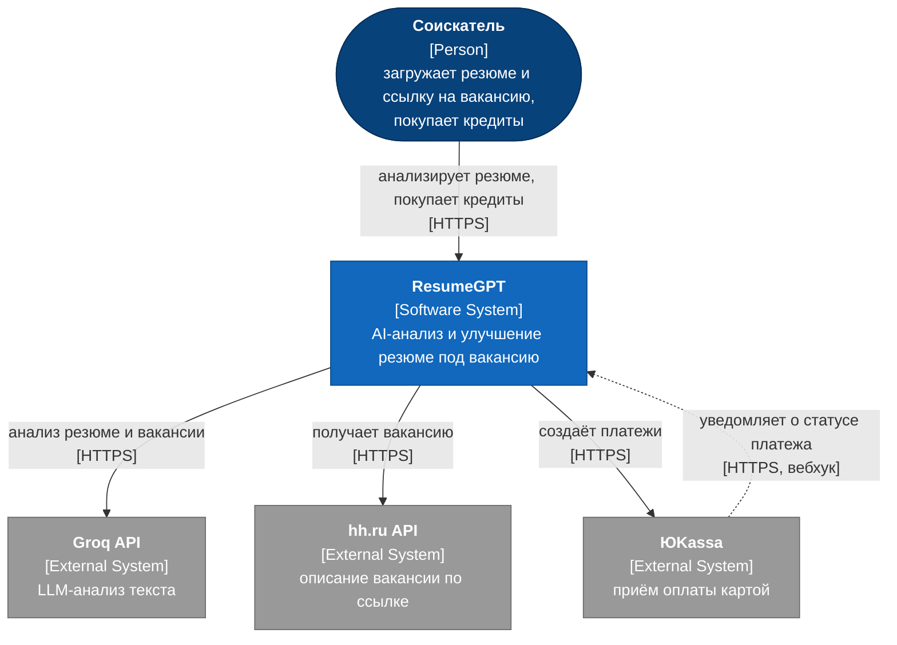

# 3. Контекст и границы системы

## 3.1. Бизнес-контекст

Диаграмма C4 уровня 1 (System Context): система целиком, её пользователь и внешние системы. Нотация C4 передана блок-схемой Mermaid: у каждого блока название, тип и назначение; сплошная стрелка — запрос, пунктир — уведомление.

| Участник | Что передаёт в систему | Что получает из системы |
|---|---|---|
| Соискатель | Файл резюме, ссылку на вакансию, режим анализа; выбор пакета кредитов | Статус и результат анализа, архив, баланс и история кредитов, ссылку на оплату |
| Groq API | Результат анализа (JSON) | Текст резюме и вакансии, промпт |
| hh.ru API | Описание вакансии | Идентификатор вакансии |
| ЮKassa | Ссылку на оплату, вебхуки о статусе платежа | Запрос на создание платежа, запрос статуса платежа |

## 3.2. Технический контекст

| Канал | Протокол | Таймаут | Поведение при сбое |
|---|---|---|---|
| Браузер → API Gateway | HTTPS, JSON, `multipart/form-data` для файла | — | Изменяющие запросы повторяются с тем же `Idempotency-Key` |
| ai-worker → Groq | HTTPS | 45 с | До 2 повторов внутри попытки, затем до 3 попыток анализа ([раздел 6](06-runtime.md)) |
| ai-worker → hh.ru | HTTPS | 5 с | Как с Groq; `404` (вакансия удалена) — сразу ошибка без повторов |
| payment-service → ЮKassa | HTTPS, ключ идемпотентности провайдера | 5 с | Повтор безопасен: тот же `Idempotence-Key` |
| ЮKassa → API Gateway → payment-service | HTTPS, вебхук | — | ЮKassa повторяет вебхук сама; reconciliation-worker раз в минуту сверяет зависшие платежи |

## 3.3. Что сознательно вне системы

- **Регистрация и вход.** API Gateway проверяет готовый JWT и передаёт в сервисы `X-User-Id`.
- **Уведомления (письма, push).** Клиент узнаёт о готовности анализа, опрашивая статус.
- **Возврат денег за неиспользованные кредиты.**
- **Собственная AI-модель и Kubernetes.**

Каждое из этого можно добавить, не меняя основу архитектуры.
