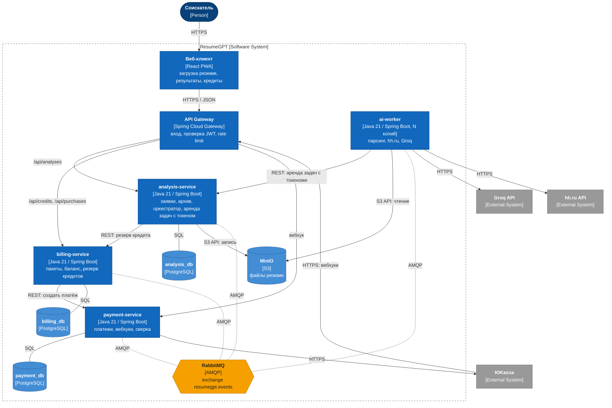
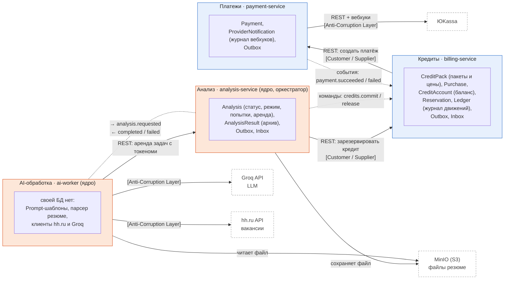
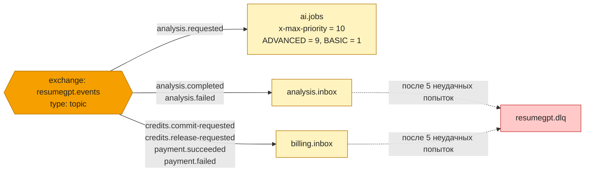
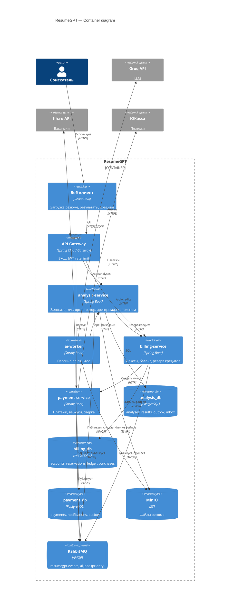

# 5. Составные части

Раздел описывает статическую структуру системы сверху вниз: сначала контейнеры (C4 уровня 2), затем границы сервисов и их данные.

## 5.1. Контейнеры системы (C4, уровень 2)

Нотация C4: у каждого блока **название**, `[технология]` и ответственность. Сплошная стрелка — синхронный вызов, пунктир — сообщения через брокер. В части 2 каждый блок станет сервисом в `docker-compose.yml`.

| Контейнер | Что внутри процесса | Масштабирование |
|---|---|---|
| Веб-клиент | React PWA из первой версии: формы загрузки, страница результата, баланс и покупка кредитов | Статика |
| API Gateway | Маршрутизация `/api/*`, проверка JWT, ограничение частоты запросов (не больше 10 анализов в минуту на пользователя), проброс `X-Request-Id` | 1 экземпляр (в учебной версии) |
| analysis-service | REST API; **outbox-relay** (раз в секунду отправляет сообщения в брокер); **watchdog** (раз в 30 с ищет просроченные аренды и зависшие заявки); потребитель результатов | Горизонтально: воркеры берут строки через `SELECT … FOR UPDATE SKIP LOCKED` |
| ai-worker | Потребитель очереди `ai.jobs`; клиенты MinIO, hh.ru, Groq; парсер PDF/DOCX (Apache Tika). Без базы | Горизонтально, 1…N копий. Каждая копия обрабатывает одну задачу за раз (`prefetch = 1`) |
| billing-service | REST API; outbox-relay; потребитель команд по кредитам и событий об оплате | Горизонтально |
| payment-service | REST API; приём вебхуков; outbox-relay; **reconciliation-worker** (раз в минуту сверяет с ЮKassa «зависшие» платежи) | Горизонтально |
| PostgreSQL | По отдельной базе на сервис. В учебной версии — один сервер с тремя базами и тремя пользователями, у каждого доступ только к своей | — |
| MinIO | Бакет `resumes`, путь `{userId}/{analysisId}/{имя файла}`. Правило жизненного цикла: файлы удаляются через 30 дней | — |
| RabbitMQ | Exchange `resumegpt.events` (topic), очереди сервисов, приоритетная очередь задач, retry и DLQ | 1 узел (в учебной версии) |

## 5.2. Границы сервисов (карта контекстов)

Каждый сервис — отдельный ограниченный контекст (bounded context): у него своя модель, своя база и свой язык. Одно и то же слово в разных контекстах значит разное. Например, «анализ» в `analysis-service` — это заявка со статусом и историей попыток. В `ai-worker` это разовая задача: «вот файл и ссылка, верни JSON». А в `billing-service` анализ — просто повод зарезервировать один кредит.

**Как читать.** Сплошная стрелка — синхронный вызов (REST), пунктир — асинхронное сообщение через RabbitMQ. Стрелка направлена от того, кто инициирует; у пунктира между анализом и AI-обработкой направление каждого сообщения указано в подписи. Оранжевым отмечено ядро домена — то, ради чего продукт существует (анализ резюме). Синим — поддерживающие контексты (деньги).

**Типы связей (термины DDD):**

- **Customer / Supplier.** Сервис-«заказчик» пользуется стабильным API «поставщика». `analysis-service` — заказчик `billing-service` (резерв кредита), `billing-service` — заказчик `payment-service` (создание платежа).
- **Anti-Corruption Layer (ACL).** Сервис переводит чужую модель в нашу. `ai-worker` превращает ответ Groq (свободный текст или JSON модели) в нашу строгую схему результата, а вакансию hh.ru — в простой текст требований. `payment-service` так же обращается со статусами ЮKassa. Если мы сменим LLM-провайдера или платёжку, остальные сервисы этого не заметят.
- **Published Language.** Все сообщения имеют общий конверт, описанный в [AsyncAPI](../api/asyncapi.md).

## 5.3. Сервисы

### 5.3.1. analysis-service — Анализ (ядро, оркестратор)

**Ответственность.** Принимает заявки на анализ и сохраняет файл резюме в MinIO. Для продвинутого режима резервирует кредит и ставит задачу в очередь. Выдаёт задачи воркерам в аренду, принимает результаты, отвечает за повторы и компенсации. Хранит архив результатов.

**Данные:** `analyses` (пользователь, режим `BASIC`/`ADVANCED`, статус, номер попытки, аренда до, причина ошибки, ссылка на файл), `analysis_results` (JSON результата), `outbox`, `inbox`, `idempotency_keys`.

**Почему отдельный.** Это единственный сервис, который видит заявку целиком: какой режим, сколько было попыток, зарезервирован ли кредит, не истекла ли аренда. Именно он решает «повторить» или «сдаться и вернуть кредит». Если разнести это по воркерам, логика повторов и компенсаций размажется ([ADR-0001](../adr/0001-saga-with-credit-reservation.md)). При этом он лёгкий и быстрый — только API и база — и продолжает показывать архив и статусы, даже когда Groq лежит.

### 5.3.2. ai-worker — AI-обработка

**Ответственность.** Берёт задачу из очереди и арендует её у `analysis-service`. Скачивает резюме из MinIO и достаёт из PDF/DOCX текст. По ссылке получает вакансию с hh.ru. Собирает промпт, вызывает Groq, проверяет, что ответ соответствует схеме результата. Отправляет результат или ошибку событием.

**Данные:** своей базы нет. Промпт-шаблоны лежат в коде или конфигурации ([ADR-0007](../adr/0007-lease-renewal-fencing.md)).

**Почему отдельный.** Самая тяжёлая и медленная часть системы: парсинг PDF расходует память, ответ LLM ждём до минуты. Её нужно масштабировать отдельно — 1 воркер ночью, 10 в час пик — и изолировать. Если на огромном PDF кончится память, упадёт один воркер, а не API, через который пользователи смотрят результаты и покупают кредиты. Здесь же сосредоточены все интеграции с нестабильным внешним миром: Groq и hh.ru.

### 5.3.3. billing-service — Кредиты

**Ответственность.** Каталог пакетов кредитов и их цены. Покупка пакета: создаёт заказ на покупку и платёж через `payment-service`, после оплаты зачисляет кредиты. Баланс пользователя. Резерв кредита под анализ, его окончательное списание или возврат.

**Данные:** `credit_packs`, `purchases`, `credit_accounts` (баланс, `CHECK balance >= 0`), `reservations` (**уникальность по `analysis_id`**), `ledger` (журнал всех движений, **уникальность по `(reason, ref_id)`**), `outbox`, `inbox`.

**Почему отдельный.** Здесь главное «нельзя потерять и нельзя задвоить» системы — деньги пользователя в виде кредитов. Логика простая, но должна быть абсолютно надёжной: баланс не уходит в минус, резерв на один анализ один, зачисление за одну покупку одно, каждое движение записано в журнал. Это проще гарантировать в маленьком сервисе с небольшой базой, чем внутри сервиса, который ещё и с AI возится. Кроме того, если появятся другие платные функции (например, сопроводительные письма отдельно), они тоже будут работать с кредитами через этот сервис.

### 5.3.4. payment-service — Платежи

**Ответственность.** Создание платежа в ЮKassa. Приём и проверка вебхуков, сверка «зависших» платежей с провайдером.

**Данные:** `payments` (заказ на покупку, сумма, статус, id у провайдера; **уникальность по `purchase_id`**), `provider_notifications` (журнал вебхуков как есть), `outbox`.

**Почему отдельный.** Граница с внешней платёжной системой. Здесь свои правила: проверка подлинности вебхуков, ключи идемпотентности у провайдера, сверка, хранение секретов магазина — они есть только у этого сервиса. Отделив его, мы держим секреты ЮKassa в одном месте, а её недоступность не затрагивает анализы. Сервис ничего не знает о кредитах и резюме: он проводит платёж «по заказу на сумму» и сообщает результат.

## 5.4. Топология RabbitMQ

**Приоритеты.** Задачи продвинутого анализа публикуются с приоритетом 9, базового — с приоритетом 1. RabbitMQ отдаёт воркерам сначала задачи с бо́льшим приоритетом. Так реализовано обещание тарифа «без очереди» ([ADR-0003](../adr/0003-rabbitmq-priority-queue.md)).

**Повторы.** Для `analysis.inbox` и `billing.inbox` при ошибке обработки сообщение уходит в очередь задержки и возвращается через 5 с → 30 с → 2 мин → 10 мин → 30 мин. После пятой неудачи оно попадает в `resumegpt.dlq`, срабатывает алерт, разбираем вручную. Для `ai.jobs` повторы анализа устроены иначе: ими управляет `analysis-service` (лимит попыток, возврат кредита), см. [раздел 6](06-runtime.md).

## 5.5. Чего в системе сознательно нет

- **Отдельного сервиса пользователей.** Регистрация и вход — вне задания. API Gateway проверяет JWT и передаёт в сервисы `X-User-Id`.
- **Базы у ai-worker.** Её роль играет аренда задач с токеном в `analysis-service` ([ADR-0007](../adr/0007-lease-renewal-fencing.md)).
- **Отдельного сервиса уведомлений.** Клиент узнаёт о готовности анализа, опрашивая статус. Письма — возможное развитие.
- **Общей базы данных.** Каждый сервис владеет своей схемой ([ADR-0005](../adr/0005-database-per-service-and-object-storage.md)).

## 5.6. Формальная запись C4

Та же диаграмма контейнеров в синтаксисе `C4Container` Mermaid. Автоматическая раскладка у Mermaid для C4 пока тесная, поэтому для чтения используется блок-схема из п. 5.1, а эта запись хранится как формальная.

