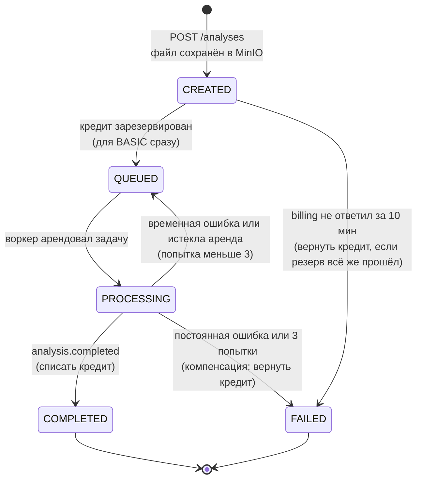
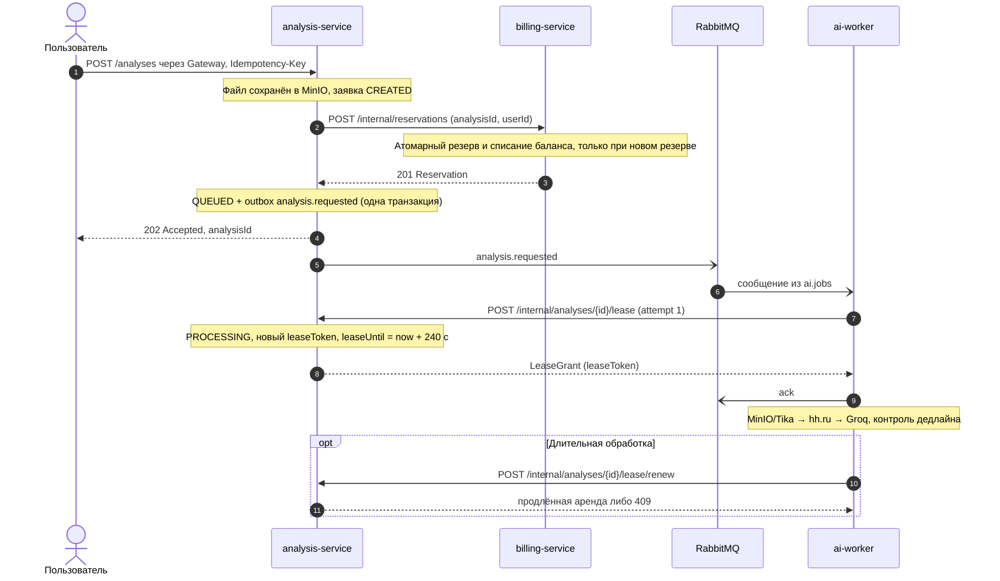
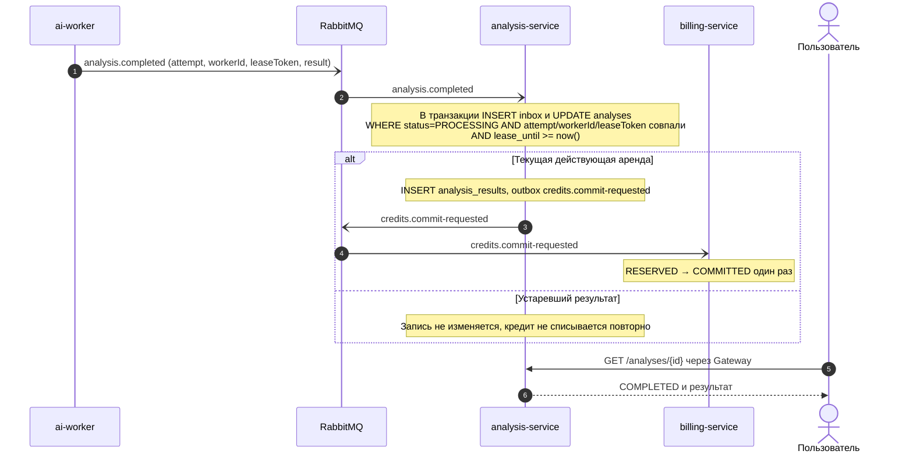
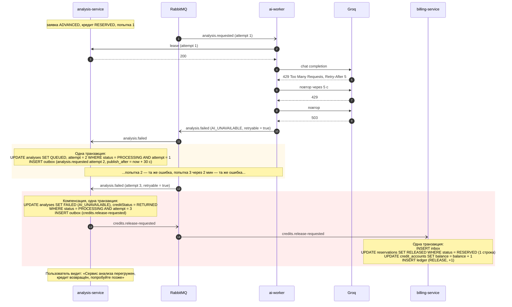
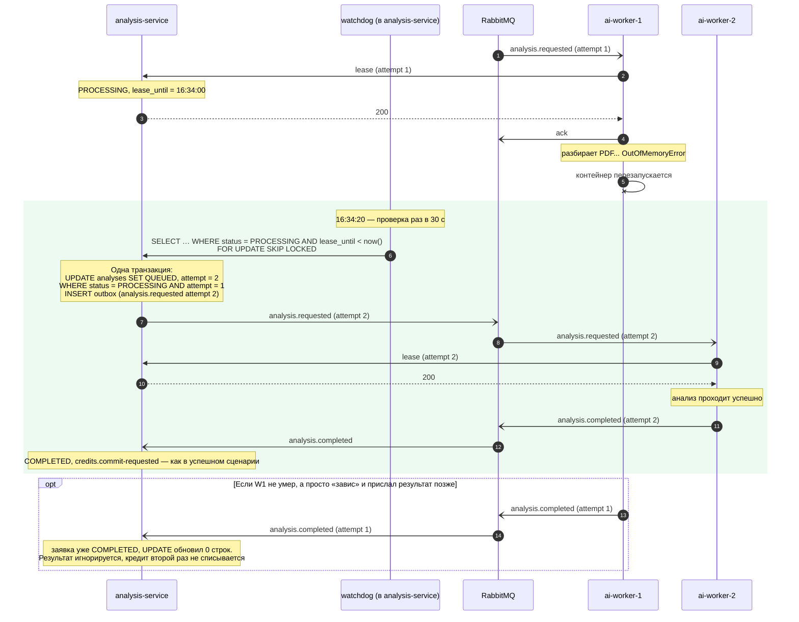
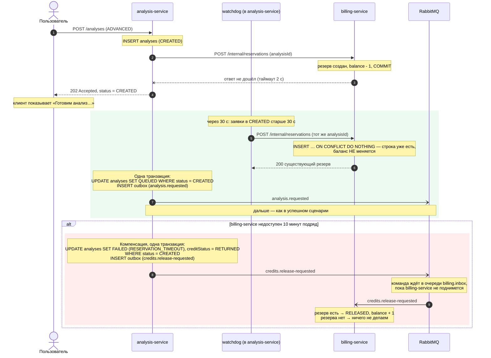
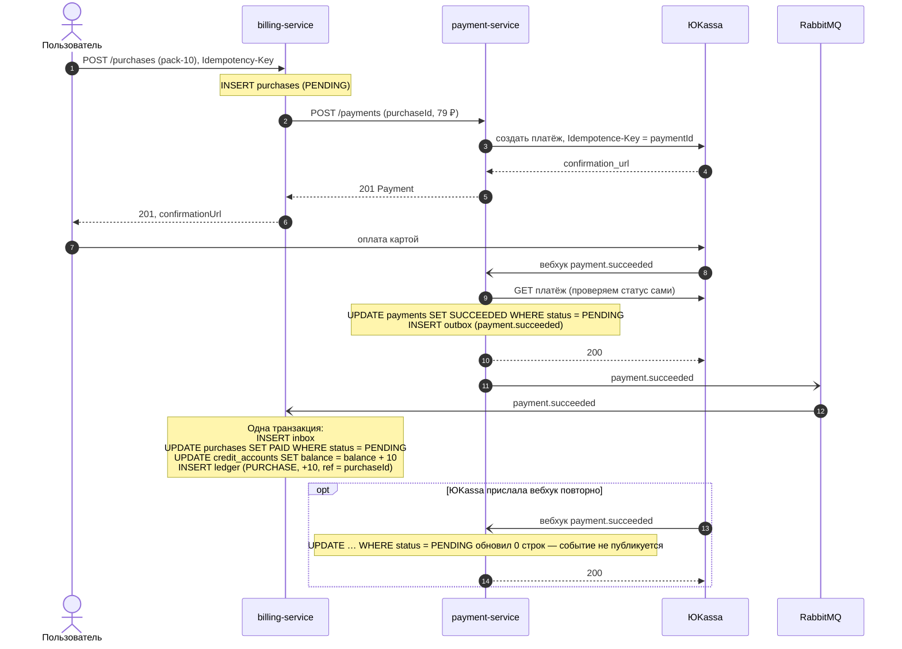

# 6. Работа в динамике

Главный процесс системы — продвинутый анализ резюме. Это **сага**: цепочка локальных транзакций в трёх сервисах (analysis, billing, ai-worker) и вызовы двух внешних систем (hh.ru, Groq). Общего `COMMIT` на всех нет, поэтому для каждого шага заранее решено, что делать при сбое и как отменить уже сделанное. Командует процессом `analysis-service` ([ADR-0001](../adr/0001-saga-with-credit-reservation.md)).

Базовый анализ проходит тот же путь, только без шагов с кредитом.

## 6.1. Жизненный цикл заявки

Это «память» оркестратора: по статусу заявки видно, на каком шаге процесс и что делать дальше.

**Правило переходов.** Каждый переход — это условный `UPDATE analyses SET status = :new WHERE id = :id AND status = :expected`. Если строка не обновилась, значит кто-то (другой воркер, watchdog, дубль события) уже перевёл заявку. Тогда мы ничего не делаем повторно. Так гонки решает база, а не удача.

**Кредит меняет судьбу ровно один раз.** Команда «списать» отправляется только при переходе в `COMPLETED`, команда «вернуть» — только при переходе в `FAILED`. Оба перехода финальные, поэтому для одного анализа отправится ровно одна из двух команд.

## 6.2. Основные гарантии

| Что нельзя | Чем обеспечено |
|---|---|
| Создать два анализа одним нажатием | `Idempotency-Key` на `POST /analyses` |
| Зарезервировать два кредита на один анализ | Первичный ключ `reservations(analysis_id)` в billing_db |
| Уйти в минус по кредитам | `CHECK (balance >= 0)` в `credit_accounts` |
| И списать, и вернуть кредит (или вернуть дважды) | Условные переходы `RESERVED → COMMITTED` / `RESERVED → RELEASED` |
| Потерять кредит при сбое анализа | Каждый путь в `FAILED` отправляет команду возврата; команды идут через outbox |
| Принять два результата или устаревший результат | Токен текущей аренды, `attempt`, `workerId` и условная фиксация (`ADR-0007`); повторный внешний вызов Groq при сбое возможен |
| Потерять задачу, если воркер умер | Watchdog возвращает задачи с истёкшей арендой в очередь |
| Зафиксировать сообщение дважды | Таблица `inbox(event_id)` у получателей с базой; результат воркера дополнительно сверяется с токеном аренды |
| Потерять сообщение | Таблица `outbox` в той же транзакции, что и изменение данных |
| Зачислить оплату дважды | Уникальность `ledger(reason, ref_id)` по `purchaseId` + условный переход покупки `PENDING → PAID` |

## 6.3. Успешный сценарий: продвинутый анализ

Сценарий разделён на два рисунка, чтобы подписи оставались читаемыми и в отчёте, и на сайте.

**Шаги 1–2: создание заявки, резерв и выполнение анализа.**

**Шаг 3: проверка попытки, сохранение результата и списание кредита.**

**Обозначения:** `->>` — синхронный HTTP-вызов, `-)` — асинхронное сообщение. «Одна транзакция» — локальная транзакция PostgreSQL внутри одного сервиса.

**Ключевые моменты:**

- Пользователь получает ответ сразу после шага 1 (`202`), дальше клиент опрашивает статус. Держать HTTP-соединение минуту, пока думает Groq, мы не стали — оно бы рвалось по таймаутам.
- Кредит **резервируется до** анализа (чтобы нельзя было запустить 100 анализов с одним кредитом), а **списывается после** (чтобы не платить за неудачу).
- Воркер подтверждает сообщение (ack) **сразу после аренды**, а не после анализа. Если воркер умрёт, задачу вернёт в очередь watchdog, а не RabbitMQ (сценарий сбоя 2).
- В сообщениях лежит только путь к файлу в MinIO, а не сам файл: сообщения остаются маленькими ([ADR-0005](../adr/0005-database-per-service-and-object-storage.md)).

## 6.4. Сбой 1: Groq недоступен или упёрся в лимит запросов

**Что ломается.** Groq отвечает `429 Too Many Requests` (бесплатные лимиты), `5xx` или не отвечает 45 секунд. Сюда же относится недоступность hh.ru. Кредит уже зарезервирован, пользователь ждёт.

**Как система справляется — три уровня:**

1. **Внутри попытки.** Воркер повторяет вызов Groq до 2 раз с паузой 2 и 5 с, учитывая заголовок `Retry-After`. Вся цепочка ограничена общим дедлайном попытки; при риске истечения аренды воркер продлевает её до разрешённого максимума или возвращает retryable-ошибку.
2. **Между попытками.** Если не помогло, воркер публикует `analysis.failed` с `retryable = true`. `analysis-service` возвращает задачу в очередь как попытку 2, а потом 3 — с паузой 30 с и 2 мин. Пауза реализована полем `publish_after` в outbox: relay отправляет сообщение не раньше этого времени.
3. **Компенсация.** После третьей неудачи заявка становится `FAILED`, и кредит **возвращается**.

Постоянные ошибки (вакансия удалена — hh.ru вернул `404`, в PDF только картинка без текста) повторять бессмысленно: сразу `FAILED` и возврат кредита.

**А если `credits.release-requested` придёт дважды?** Повтор отсеется в `inbox`. Даже без inbox условие `WHERE status = 'RESERVED'` обновит 0 строк, и баланс второй раз не увеличится.

## 6.5. Сбой 2: воркер упал посреди анализа

**Что ломается.** Воркер арендовал задачу и подтвердил сообщение, начал разбирать PDF на 4 МБ, и у него кончилась память (OOM) — контейнер перезапустился. Сообщения в очереди уже нет, задача висит в `PROCESSING`, пользователь ждёт вечно.

**Как восстанавливаемся.** В `analysis-service` работает **watchdog**: раз в 30 секунд он ищет заявки в `PROCESSING` с истёкшей арендой и возвращает их в очередь новой попыткой. Задачу берёт другой воркер. После третьей такой неудачи — `FAILED (ATTEMPTS_EXHAUSTED)` и возврат кредита, как в сценарии 1: значит, сам файл «роняет» воркеры.

**Почему не положиться на RabbitMQ (ack после окончания работы)?** Тогда при падении воркера RabbitMQ сразу отдал бы сообщение другому воркеру. Но аренда первого ещё действует, второй получил бы `409` и выбросил задачу. Два механизма мешали бы друг другу. Поэтому за «живость» задачи отвечает один механизм — аренда ([ADR-0004](../adr/0004-stateless-worker-with-lease.md)).

**Дубль сообщения в очереди** (RabbitMQ доставил `analysis.requested` повторно) обрабатывается так же просто: второй воркер просит аренду, получает `409` (задача уже не `QUEUED`), подтверждает сообщение и берёт следующую задачу. Groq второй раз не вызывается.

## 6.6. Сбой 3: сбой между резервом кредита и постановкой в очередь

**Что ломается.** Самое «узкое» место саги — шаг 1, где участвуют два сервиса синхронно. `analysis-service` вызвал резерв кредита, `billing-service` его выполнил, но:

- ответ потерялся по дороге (таймаут 2 с) — `analysis-service` не знает, зарезервирован ли кредит;
- или `analysis-service` упал сразу после ответа, не успев перевести заявку в `QUEUED`.

Кредит списан с баланса, а задача не в очереди. Если ничего не делать, кредит пропал.

**Как восстанавливаемся.** Заявка остаётся в `CREATED`. Пользователь получает `202`, а клиент показывает «Готовим анализ…». Watchdog раз в 30 секунд берёт заявки в `CREATED` старше 30 секунд и **повторяет резерв**. Резерв идемпотентен по `analysisId`:

- если кредит уже был зарезервирован — billing вернёт существующий резерв (`200`), второй кредит не спишется, заявка уйдёт в очередь;
- если billing так и не ответил за 10 минут — заявка становится `FAILED (RESERVATION_TIMEOUT)` и отправляется команда возврата. Если резерв на самом деле был — кредит вернётся; если не был — команда ничего не изменит.

Если же billing-service ответил **отказом соединения** (точно лежит), заявка удаляется сразу, а пользователь получает `503` с подсказкой «продвинутый анализ временно недоступен, можно запустить базовый». Базовый анализ от billing-service не зависит.

## 6.7. Покупка пакета кредитов

Короткая сага с той же защитой от двойного зачисления.

Если `payment-service` был недоступен, когда пришёл вебхук, ЮKassa повторит уведомление сама. Кроме того, `reconciliation-worker` раз в минуту сверяет с ЮKassa платежи, которые висят в `PENDING` дольше 2 минут. Оба пути идут через один условный `UPDATE`, поэтому кредиты зачислятся ровно один раз.

**Контрактная защита поздних событий:** оба результата воркера (`analysis.completed` и `analysis.failed`) несут `leaseToken`; после увеличения attempt старый токен недействителен. Возможность повторного внешнего запроса сохраняется, но результат старого воркера не побеждает.
