# 7. Развёртывание

## 7.1. Учебная версия: docker-compose

В части 2 вся система запускается одной командой `docker compose up` на компьютере разработчика. Каждый контейнер из [раздела 5](05-building-blocks.md) — отдельный сервис в `docker-compose.yml`. Подробные связи между сервисами показаны в разделе 5, здесь — только размещение.

```mermaid
flowchart LR
    classDef svc fill:#1168bd,stroke:#0b4884,color:#fff
    classDef infra fill:#438dd5,stroke:#2e6295,color:#fff
    classDef ext fill:#999,stroke:#6b6b6b,color:#fff
    classDef node fill:#ffffff,stroke:#666,color:#222

    browser["Браузер пользователя"]:::node

    subgraph HOST["Компьютер разработчика · Docker · сеть docker-compose"]
        gw["api-gateway · порт 8000 наружу"]:::svc
        subgraph APP["Сервисы · внутренний порт 8080"]
            an["analysis-service"]:::svc
            bl["billing-service"]:::svc
            pm["payment-service"]:::svc
            w["ai-worker × N"]:::svc
        end
        subgraph INFRA["Инфраструктура"]
            pg[("postgres<br/>3 базы")]:::infra
            mq{{"rabbitmq<br/>:5672, консоль :15672"}}:::infra
            s3[("minio<br/>бакет resumes")]:::infra
        end
        gw --> APP
        APP --> INFRA
    end

    subgraph EXT["Внешние системы (HTTPS)"]
        groq["Groq API"]:::ext
        hh["hh.ru API"]:::ext
        yk["ЮKassa"]:::ext
    end

    browser -- "HTTPS /api/*" --> gw
    HOST --> EXT
```

| Контейнер | Сколько экземпляров | Доступ снаружи | Примечание |
|---|---|---|---|
| api-gateway | 1 | Порт 8000, адрес `http://localhost:8000/api` | Единственная точка входа для браузера и вебхуков ЮKassa |
| analysis-service | 1 (можно больше) | Нет | Внутренний адрес `http://analysis-service:8080` |
| billing-service | 1 (можно больше) | Нет | Внутренний адрес `http://billing-service:8080` |
| payment-service | 1 (можно больше) | Нет | Внутренний адрес `http://payment-service:8080`; единственный хранит секреты магазина ЮKassa |
| ai-worker | 1…N | Нет | Без базы; число копий задаёт `docker compose up --scale ai-worker=N` |
| postgres | 1 сервер, 3 базы | Нет | У каждой базы свой пользователь с доступом только к ней ([ADR-0005](../adr/0005-database-per-service-and-object-storage.md)) |
| rabbitmq | 1 узел | Веб-консоль на порту 15672 | Exchange `resumegpt.events`, очереди `ai.jobs`, `analysis.inbox`, `billing.inbox`, `resumegpt.dlq` |
| minio | 1 | Нет | Бакет `resumes`, файлы удаляются через 30 дней; отдельные ключи доступа на запись (analysis-service) и чтение (ai-worker) |

## 7.2. Запуск и загрузка

1. Запускаются инфраструктурные контейнеры: `postgres`, `rabbitmq`, `minio`.
2. Запускаются сервисы. Каждый сервис с базой подключается к своей базе, к брокеру и, при необходимости, к MinIO.
3. Запускаются фоновые процессы внутри сервисов:
   - outbox-relay в analysis, billing и payment — раз в секунду отправляет сообщения из таблицы `outbox`;
   - watchdog в analysis-service — раз в 30 с ищет просроченные аренды и зависшие заявки;
   - reconciliation-worker в payment-service — раз в минуту сверяет зависшие платежи с ЮKassa.
4. Воркеры подписываются на очередь `ai.jobs` с `prefetch = 1` и начинают брать задачи.

Порядок запуска сервисов не важен для корректности: всё состояние хранится в базах, сообщения — в `outbox` и durable-очередях. Сервис, запущенный раньше брокера, копит сообщения в `outbox` и отправит их, когда брокер станет доступен.

При реализации у сервисов может быть доступен диагностический Swagger UI по адресу `/swagger-ui.html` (springdoc-openapi). Он **не является источником истины**: в CI потребуется сверять `/v3/api-docs` с версионированными OpenAPI-файлами из репозитория (см. [справочник API](../api/index.md)). До появления кода эта проверка не выполняется.

## 7.2а. Версии и минимальные ресурсы (плановая конфигурация)

В переданном комплекте отсутствуют `pom.xml` и `docker-compose.yml`. Поэтому **фактически используемые версии** Spring Boot, PostgreSQL, RabbitMQ, MinIO, Apache Tika и Docker Compose установить нельзя: ниже приведены только известные требования и предварительные ресурсы, требующие замеров при реализации.

| Компонент | Версия или статус фиксации |
|---|---|
| Java | 21 (установлено проектом) |
| Spring Boot, Apache Tika | Версии будут закреплены в `pom.xml` |
| PostgreSQL, RabbitMQ, MinIO | Теги образов будут зафиксированы в `docker-compose.yml`; `latest` запрещён для воспроизводимой сборки |
| Docker / Docker Compose | Указать проверенные версии в инструкции по запуску части 2 |
| Groq, hh.ru API, ЮKassa API | Внешние интерфейсы: версии SDK/HTTP-клиента фиксируются в зависимости реализации |

**Предварительная минимальная учебная конфигурация (оценка, не результат тестирования):** 4 логических ядра CPU, 8 ГБ оперативной памяти, от 15 ГБ свободного диска; для параллельных AI-воркеров ресурсный бюджет увеличивается. После реализации нужны измерения памяти Tika, PostgreSQL и размера файлов в MinIO, а также корректировка значений. Для промышленного использования и отказоустойчивости эти числа не подходят.

## 7.3. Целевая промышленная схема

Отличия от учебной версии, которые не меняют архитектуру:

| Учебная версия | Промышленная версия |
|---|---|
| Один сервер PostgreSQL с тремя базами | Отдельный сервер PostgreSQL на каждый сервис |
| Число воркеров задаётся вручную | Число воркеров меняется по нагрузке: например, 1 ночью и 10 в час пик |
