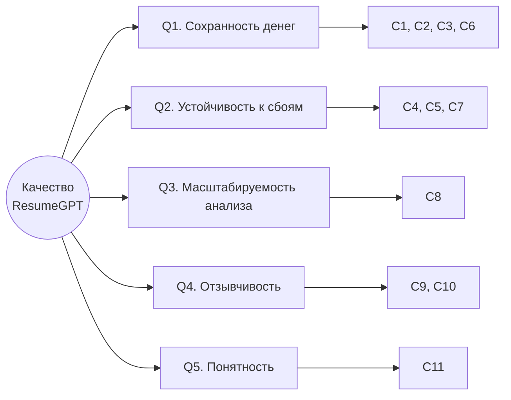

# 10. Требования к качеству

## 10.1. Дерево качества

## 10.2. Сценарии качества

| № | Ситуация | Ожидаемое поведение системы |
|---|---|---|
| С1 | Пользователь с 1 кредитом одновременно запускает 10 продвинутых анализов | Резервируется не больше 1 кредита: `CHECK (balance >= 0)`; остальные запросы получают `402` |
| С2 | Команда `credits.release-requested` доставлена дважды | Кредит возвращается один раз: повтор отсеивается `inbox`, условный `UPDATE` обновляет 0 строк |
| С3 | ЮKassa присылает вебхук об оплате повторно | Кредиты зачисляются один раз: условный переход `PENDING → PAID` и уникальность `ledger(reason, ref_id)` |
| С4 | Groq отвечает `429` или `5xx` | До 2 повторов внутри попытки, затем до 3 попыток с паузами 30 с и 2 мин; после третьей неудачи — `FAILED` и возврат кредита |
| С5 | Воркер упал посреди анализа | После истечения текущей аренды (базово 4 минуты с ограниченным продлением) watchdog (раз в 30 с) переотправляет задачу; устаревший результат не принимается |
| С6 | Воркер прислал результат старой аренды после начала следующей попытки | Результат отвергается по `attempt` и `leaseToken`, кредит не меняется |
| С7 | RabbitMQ недоступен | Сервисы продолжают принимать запросы, сообщения копятся в `outbox` и уходят после подъёма брокера |
| С8 | Резкий рост числа заявок | Заявки ждут в очереди `ai.jobs`, а не получают ошибки; добавление воркеров — запуск ещё копий контейнера |
| С9 | Пользователь запускает анализ | Ответ `202 Accepted` сразу после приёма заявки, без ожидания LLM; клиент опрашивает статус раз в 2 с |
| С10 | В очереди одновременно платные и бесплатные задачи | Воркеры берут сначала задачи с приоритетом 9 (продвинутый анализ), затем с приоритетом 1 |
| С11 | Нужно выяснить, где застрял анализ | Статус заявки показывает шаг саги, номер попытки — сколько раз пытались; все логи находятся по `correlationId` |

## 10.3. Количественные параметры

| Параметр | Значение |
|---|---|
| Максимальный размер файла резюме | 5 МБ |
| Ограничение частоты запусков анализа | не больше 10 в минуту на пользователя (API Gateway) |
| Таймауты | межсервисный HTTP — 2 с; hh.ru — 5 с; Groq — 45 с; ЮKassa — 5 с |
| Аренда задачи воркером | Базово 240 с, продление до общего дедлайна 5 мин; проверка attempt/leaseToken |
| Лимит попыток анализа | 3 |
| Таймаут резерва кредита при недоступном billing-service | 10 минут, затем `FAILED` и команда возврата |
| Повторы обработки сообщений в `analysis.inbox` и `billing.inbox` | 5 с → 30 с → 2 мин → 10 мин → 30 мин, затем DLQ |
| Хранение ключей идемпотентности | 24 часа |
| Хранение файлов резюме | 30 дней; срок хранения результатов не утверждён |
